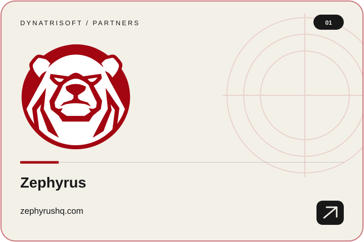
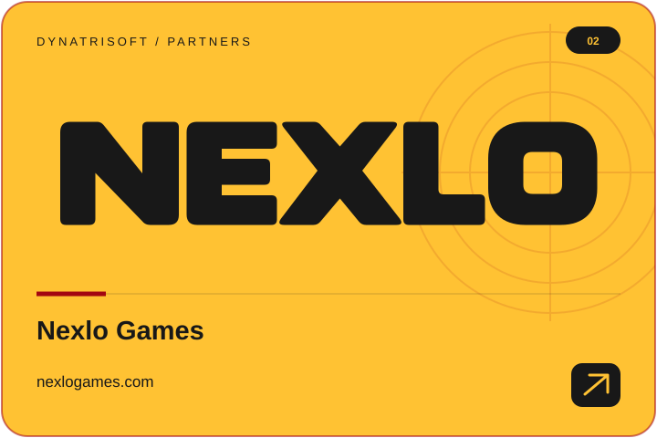

  <a href="https://dynatrisoft.com">
    <picture>
      <source media="(prefers-color-scheme: dark)" srcset="https://raw.githubusercontent.com/dynatrisofthq/.github/main/profile/assets/banner-dark.svg">
      <source media="(prefers-color-scheme: light)" srcset="https://raw.githubusercontent.com/dynatrisofthq/.github/main/profile/assets/banner-light.svg">
      
    </picture>
  </a>

  
  
  
  
  
  

## Ideas deserve thoughtful execution.

**DynatriSoft Studios** brings a studio mindset to software: curiosity to explore, care to craft, and discipline to build with purpose.

Our focus is simple: turn ideas into useful digital experiences, with attention to the people who use them and the engineering that supports them.

### Games

  

### Partners

  
  

### Explore the studio

This is our home on GitHub. Browse the public repositories to discover what we share, read the documentation, and follow the work that interests you.

For questions or contributions to a public project, start with its README and contribution guidelines. Each repository defines its own scope, support channels, and license.

  
<strong>Behind the name and the mark</strong>

 

Our visual identity brings together a geometric monogram, a four-point star, and a blue gradient. Its construction uses Fibonacci proportions—a small expression of the balance between creativity and precision that informs the studio's identity.

**DynatriSoft Studios** is a brand of **ZEPHYRUS PROSPERITY - UNIPESSOAL LDA**, the company behind the studio.

---

  <strong>Have an idea worth building?</strong> 
  Get to know the studio at <a href="https://dynatrisoft.com">dynatrisoft.com</a>.

  DynatriSoft Studios · ZEPHYRUS PROSPERITY - UNIPESSOAL LDA

